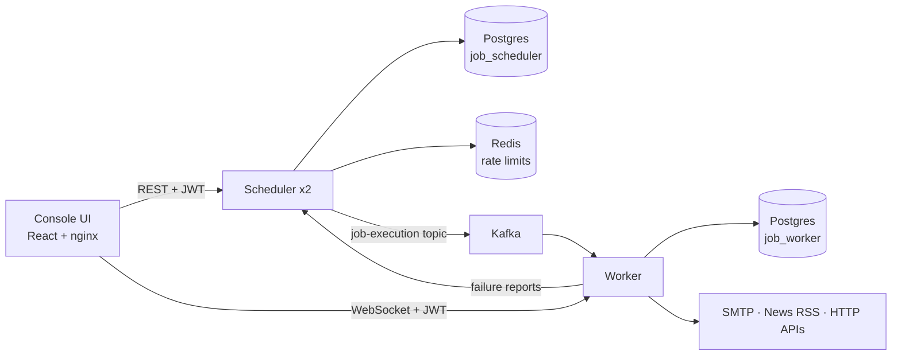

# Chronos — distributed job scheduler

Schedule work to run after a delay, at a time, or on a cron, and have it run once per occurrence, even with several scheduler replicas.
Java 21 · Spring Boot · Kafka · PostgreSQL · Redis · React · Docker · Kubernetes.

**Live demo:** _add your URL here_ · sign up with any user ID to try it.

## Architecture



The scheduler owns time and state. The worker owns side effects. Kafka sits between them, so either side can restart without losing queued work.

## How it works

1. **Leases in Postgres, claimed with `SKIP LOCKED`.** Each job has a lease row (`next_run_at`, `locked_until`). Every second each scheduler replica claims up to 50 due rows with `UPDATE … WHERE job_id IN (SELECT … FOR UPDATE SKIP LOCKED)`. Two replicas never claim the same job; a crashed replica's lease expires after 30 s and another replica takes over.
2. **Deterministic execution IDs.** Each occurrence gets `executionId = jobId_scheduledAt`. The worker inserts the execution row first, behind a unique constraint, so a Kafka redelivery is skipped. The same ID goes out as `X-Idempotency-Key` on outbound HTTP jobs.
3. **The publish result drives the next state.** On Kafka ack, a cron job gets its next run time; a one-off job is marked done. A failed send retries after 30 s (2 min for cron), up to `maxRetries`.
4. **Auth everywhere.** The scheduler issues HS256 JWTs. The worker verifies the same token on its REST API and on the WebSocket handshake (`?token=`), and takes the user's identity only from the token.

Job types: email (admin-only), in-app reminder, news headlines (Google News RSS), failed-jobs CSV report, and four outbound-HTTP jobs (payment retry, order expiry, hotel night audit, data sync).

## Run locally

```bash
cp .env.example .env    # then fill in the values (openssl rand -base64 48 for the JWT secret)
docker compose up --build
```

Open http://localhost:5173. Compose refuses to start if a required secret is missing.

Tests:

```bash
(cd job-scheduler-service && mvn test) && (cd job-worker-service && mvn test)
```

## Deploy on Kubernetes

The `k8s/` folder is a Kustomize app: Postgres, Redis and Kafka (single-node KRaft) as stateful pods, two scheduler replicas, one worker, and the UI behind a Traefik Ingress. Only the UI is exposed; its nginx proxies `/api/scheduler`, `/api/worker` and `/ws` to the internal services.

1. Push to `main`. GitHub Actions runs the tests and pushes multi-arch images (amd64 + arm64) to `ghcr.io/<you>/chronos-{scheduler,worker,ui}`. Make the three packages public.
2. Get a cluster. Free option: Oracle Cloud OKE **Basic** cluster with one Ampere A1 node, or k3s on one A1 VM (`curl -sfL https://get.k3s.io | sh -`).
3. On OKE only, install Traefik: `helm install traefik traefik/traefik -n traefik --create-namespace`.
4. Create the secrets (never commit them):

```bash
kubectl create namespace chronos
```

```bash
kubectl -n chronos create secret generic chronos-secrets --from-literal=DB_PASSWORD="$(openssl rand -hex 16)" --from-literal=CHRONOS_JWT_SECRET="$(openssl rand -base64 48)" --from-literal=CHRONOS_INTERNAL_KEY="$(openssl rand -hex 24)" --from-literal=CHRONOS_BOOTSTRAP_ADMIN_PASSWORD="<choose one>"
```

5. In `k8s/kustomization.yaml`, set `PUBLIC_ORIGIN` to your URL and replace `YOUR_GITHUB_USER`, then:

```bash
kubectl apply -k k8s/
```

The first start can restart a scheduler pod once while both replicas create the schema at the same time (see limitations).

## Known limitations

These are deliberate scope cuts, each with the fix I would make next.

| Limitation | Effect | Next fix |
| --- | --- | --- |
| A worker crash mid-job leaves the execution row in `PROCESSING`, and redelivery skips it | That occurrence is lost | Treat `PROCESSING` older than N minutes as retryable; add a sweeper |
| A job shows `COMPLETED` once Kafka accepts it; execution failures are recorded but not retried | Status means "dispatched", not "succeeded" | Feed worker results back into job status; retry with backoff |
| No optimistic locking on jobs | A cron edit made while a slow publish is in flight can be overwritten | `@Version` on the job entity and a per-claim lease token |
| Schema comes from Hibernate `ddl-auto=update` | Schema drift; a race on first start with 2 replicas | Flyway migrations |
| Realtime history is in worker memory | Lost on restart; the worker must run as 1 replica | Store events in Postgres or Redis pub/sub |
| Cron runs in UTC | Users must convert their local time (the UI says UTC) | Per-job time zone |
| Login is not rate-limited | Password guessing is only slowed by BCrypt | Rate-limit `/v1/auth/**` per IP |

## Project layout

| Path | What |
| --- | --- |
| `job-scheduler-service/` | Auth, job API, lease claiming, Kafka publisher |
| `job-worker-service/` | Kafka consumer, job handlers, WebSocket hub, reports |
| `job-console-ui/` | React console served by nginx |
| `k8s/` | Kustomize manifests |
| `.github/workflows/ci.yml` | Tests and multi-arch image builds |
